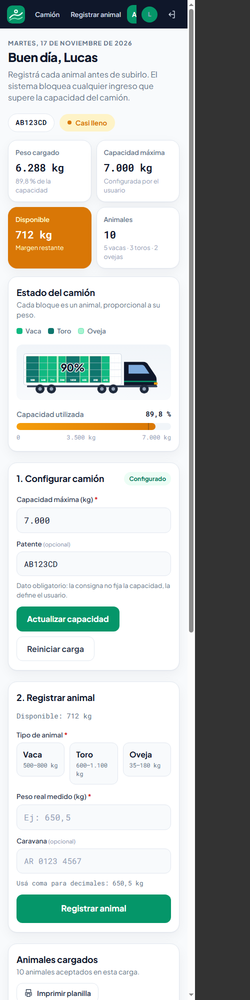

# NexoRural · Control de carga ganadera

**Equipo: AGO Soluciones**

Aplicación web para registrar el peso de cada animal antes de subirlo al camión y **bloquear cualquier ingreso que supere la capacidad máxima** configurada. Incluye login real, historial de viajes y gestión de usuarios con PHP + MySQL.


## Dos formas de usarla

| | **Con servidor (recomendado)** | **Modo local** |
|---|---|---|
| Cómo se abre | `http://localhost/nexorural` (XAMPP) | Doble clic en `index.html` |
| Dónde se guardan los datos | Base MySQL, compartida entre equipos | Solo en ese navegador |
| Login | Real (usuario y contraseña, con bloqueo por intentos) | Solo el nombre |
| Historial de cargas | ✅ | ✅ (de ese navegador) |
| Gestión de usuarios | ✅ (administradores) | — |

La app detecta sola el modo y lo muestra arriba a la derecha: **Conectado** o **Modo local**.

### Instalar con XAMPP (una sola vez)

1. Copiá la carpeta `nexorural` dentro de `C:/xampp/htdocs/`.
2. En el panel de XAMPP encendé **Apache** y **MySQL**.
3. Entrá a `http://localhost/phpmyadmin` → **Importar** → `database/nexorural_estructura.sql` → **Continuar**.
4. Abrí `http://localhost/nexorural`. La primera vez te pide crear el **administrador**.
5. Desde **Administración** creá las cuentas de los capataces y, si querés, los camiones y categorías.

Si MySQL tiene contraseña o usás otro servidor, cambiá los datos en `api/config.php`.

> **Alternativa al paso 1 (la que usamos en desarrollo):** en lugar de copiar, crear un *enlace* para que Apache sirva directamente la carpeta del repositorio y no haya dos copias. En PowerShell:
> `New-Item -ItemType Junction -Path C:\xampp\htdocs\nexorural -Target "<carpeta del repositorio>"`
> El `.htaccess` de la raíz bloquea `.git` y `scripts/` para que no se vean desde la web.

### Usar desde el celular

1. En la PC con XAMPP ejecutá **una sola vez** `scripts\habilitar-celulares.bat` (doble clic → aceptar el permiso de administrador). Agrega una regla al Firewall de Windows que deja entrar a Apache **solo desde el wifi local**.
2. Como administrador, entrá a **Administración**: arriba aparece la dirección para celulares (ej. `http://192.168.1.18/nexorural/`) con botones para copiarla o mandarla por WhatsApp.
3. En el celular (conectado al **mismo wifi**), abrí esa dirección. Desde el menú del navegador se puede **"Agregar a la pantalla de inicio"** y queda como una app con su ícono.

En el celular, con una carga en curso, lo primero que aparece es el formulario de **Registrar animal**.

> La IP de la PC la asigna el router y puede cambiar. Si un día el celular no entra, revisá la dirección en **Administración**. Para que no cambie, se puede reservar la IP en el router.

### Respaldos de la base de datos

| Script | Qué hace |
|---|---|
| `scripts\respaldo.bat` | Crea un respaldo completo en `Documentos\NexoRural-respaldos\` y borra los de más de 30 días |
| `scripts\programar-respaldo.bat` | Programa el respaldo **todos los días a las 20:00** (si la PC estaba apagada, lo hace al encenderla) |
| `scripts\restaurar-respaldo.bat` | Restaura un respaldo. Pide confirmar con **SI** y antes guarda una copia del estado actual |

Copiá la carpeta `Documentos\NexoRural-respaldos` a un pendrive o a Google Drive/OneDrive cada tanto: si se rompe la PC, el respaldo tiene que estar en otro lado.

### Funciona sin internet

Las tipografías están incluidas en el proyecto (`assets/fonts/`, licencia SIL OFL): la app no necesita conexión a internet, solo el wifi local.

## Cómo usarla

1. **Ingresar** con tu usuario y contraseña.
2. **Configurar camión**: elegí un **camión guardado** (completa solo la capacidad y la patente) o escribí los datos → *Iniciar carga*.
3. **Registrar animal**: elegí vaca, toro u oveja, escribí el peso real y tocá *Registrar animal*.
4. El sistema calcula `pesoAcumulado + pesoNuevo`:
   - si es **≤ capacidad**, acepta el animal y actualiza los indicadores;
   - si es **> capacidad**, muestra **«Capacidad máxima superada»** y no cambia nada.
5. Si cargaste algo mal, **corregilo** con el lápiz ✏️ (tipo, peso o caravana) o **eliminalo** con la papelera (podés *Deshacer*). La corrección también respeta la capacidad del camión.
6. Al terminar, **Cerrar carga** (con observaciones opcionales): queda en el **Historial**.
   Si el viaje no sale, **Cancelar carga** (también queda registrado, como cancelado).
7. *Imprimir planilla* genera una hoja con el detalle y lugar para la firma; *Excel (CSV)* la descarga para Excel.

### Historial

Todas las cargas con filtros por estado y fechas, totales del período (kilos transportados, animales, uso promedio del camión), detalle de cada viaje, reimpresión de la planilla y exportación a CSV.

### Administración (solo administradores)

- **Usuarios:** alta de capataces y administradores, activar/desactivar cuentas y asignar una contraseña nueva si alguien se la olvida.
- **Camiones guardados:** patente, descripción y capacidad. Aparecen en una lista al iniciar la carga.
- **Categorías de animales:** además de vaca, toro y oveja, se pueden crear otras (ternero, novillo, vaquillona…) con su rango orientativo, editarlas o desactivarlas. Cada una tiene su color en el camión y en las tablas.
- **Acceso desde celulares:** la dirección para el wifi, con botones para copiarla o mandarla por WhatsApp.

### Mi contraseña

Cualquier usuario puede cambiar su propia contraseña con el botón 🔑 de la tarjeta de usuario (abajo a la izquierda).

## Funciones (requisitos del análisis)

| Código | Requisito | Dónde |
|---|---|---|
| RF-01 | Configurar capacidad máxima | Tarjeta «1. Configurar camión» |
| RF-02 | Seleccionar tipo de animal | Botones Vaca / Toro / Oveja |
| RF-03 | Ingresar peso | Campo «Peso real medido» (acepta `650,5` o `1.100`) |
| RF-04 | Validar datos | Rechaza vacío, texto, 0 y negativos: «Ingrese datos válidos» |
| RF-05 | Controlar capacidad | `js/logic.js`, `api/carga.php` y triggers de la base |
| RF-06 | Bloquear exceso | Mensaje en rojo «Capacidad máxima superada» + el camión marca el exceso |
| RF-07 | Actualizar indicadores | Peso cargado, capacidad, disponible, cantidad y barra de progreso |
| RF-08 | Listar registros | Tabla «Animales cargados» con acumulado |
| RF-09 | Eliminar registro | Botón de papelera, recalcula todo, con opción *Deshacer* |

Topes contra errores de tipeo: capacidad hasta **60.000 kg** y animal hasta **2.000 kg** (en la app, en PHP y en la base).

Extras: advertencia si el peso está fuera del rango orientativo (hay que confirmar), caravana, patente, barra que pasa a ámbar al 85 % y a rojo al llenarse, diseño para celular/tablet/PC, planilla imprimible y exportación CSV.

## Seguridad

- Contraseñas con `password_hash()` (nunca en texto plano).
- 5 intentos fallidos bloquean el usuario 5 minutos.
- Sesión con cookie `HttpOnly` y `SameSite=Strict`, más un encabezado obligatorio en cada envío (protección CSRF).
- Consultas preparadas con PDO (sin inyección SQL) y MySQL en modo estricto.
- La regla de capacidad se valida **tres veces**: en el navegador, en PHP (bloqueando la carga para que dos celulares no la superen al mismo tiempo) y en la base (triggers).
- Los archivos internos de `api/` no se pueden abrir desde el navegador (`api/.htaccess`).
- El CSV neutraliza fórmulas para que no se ejecuten al abrirlo en Excel.

## Estructura del proyecto

```
nexorural/
├── index.html              Ingreso (y alta del primer administrador)
├── panel.html              Panel de carga
├── historial.html          Historial de cargas
├── administracion.html     Usuarios, camiones, categorías y acceso desde celulares
├── css/styles.css          Estilos (paleta y tipografías del análisis)
├── js/
│   ├── logic.js            Reglas de negocio (sin interfaz, testeable)
│   ├── store.js            Guardado: servidor PHP o navegador (misma interfaz)
│   ├── ui.js               Utilidades comunes (barra lateral, planilla, CSV)
│   ├── app.js              Panel de carga
│   ├── historial.js        Historial
│   ├── administracion.js   Administración
│   └── login.js            Ingreso
├── api/                    Backend PHP 8 + MySQL (PDO)
│   ├── config.php          Datos de conexión y límites
│   ├── auth.php            Ingreso, salida y alta del primer administrador
│   ├── carga.php           Carga en curso (iniciar, registrar, eliminar, cerrar…)
│   ├── catalogo.php        Categorías de animales y camiones guardados
│   ├── historial.php       Listado y detalle de cargas
│   └── usuarios.php        Alta, activar/desactivar, cambiar contraseña
├── manifest.webmanifest    Para instalarla en el celular ("Agregar a pantalla de inicio")
├── .htaccess               Bloquea .git y scripts/ desde la web
├── assets/                 Logo, íconos, fondo del ingreso y tipografías (fonts/)
├── scripts/                Windows: habilitar celulares, respaldo, programar y restaurar
├── database/
│   ├── nexorural_estructura.sql   Estructura para phpMyAdmin
│   └── datos_iniciales.sql        Catálogo de especies (opcional)
├── tests/
│   ├── index.html          Casos de prueba en el navegador
│   ├── casos.js            Casos de la sección 12 y más
│   └── run-node.js         Mismos casos desde la terminal
└── docs/
    ├── GUIA_BASE_DE_DATOS.md
    ├── Analisis_informatico_control_carga_ganadera.docx
    └── capturas/
```

## API

Todas las respuestas son JSON (`{ "ok": true, ... }` o `{ "ok": false, "mensaje": "...", "motivo": "..." }`). Los envíos (`POST`) llevan JSON y el encabezado `X-Requested-With: NexoRural`.

| Archivo | Acciones |
|---|---|
| `auth.php` | `estado` (GET), `instalar`, `login`, `logout`, `mi_clave` |
| `carga.php` | `actual` (GET), `iniciar` (con `camionId` opcional), `capacidad`, `registrar`, `editar`, `eliminar`, `restaurar`, `rechazo`, `cerrar`, `cancelar` |
| `catalogo.php` | `tipos`, `camiones` (GET, cualquier usuario); `camiones_todos`, `tipo_guardar`, `tipo_activo`, `camion_guardar`, `camion_activo` (administradores) |
| `historial.php` | `listar` (GET, filtros `estado`, `desde`, `hasta`), `detalle` (GET, `id`) |
| `usuarios.php` | `listar` (GET), `red` (GET, dirección para celulares), `crear`, `activo`, `clave` — solo administradores |

## Pruebas

- Reglas de negocio: `tests/index.html` en el navegador o `node tests/run-node.js` (19 casos, incluye todos los de la sección 12).

## Base de datos

Estructura en `database/nexorural_estructura.sql` y guía paso a paso en [docs/GUIA_BASE_DE_DATOS.md](docs/GUIA_BASE_DE_DATOS.md).

## Diseño

- Azul pizarra `#0F172A` / `#1E293B`: barra lateral y textos
- Verde esmeralda `#059669` / `#10B981`: botones principales y estados OK
- Ámbar `#D97706` y rojo `#DC2626`: advertencias y exceso de carga
- Gris hielo `#F8FAFC` y blanco: fondos de tablas y formularios
- Tipografías: **Plus Jakarta Sans** (interfaz) y **Roboto Mono** (pesos, patentes y caravanas)


<p align="center"> </p>

---

Desarrollado por **AGO Soluciones**.
