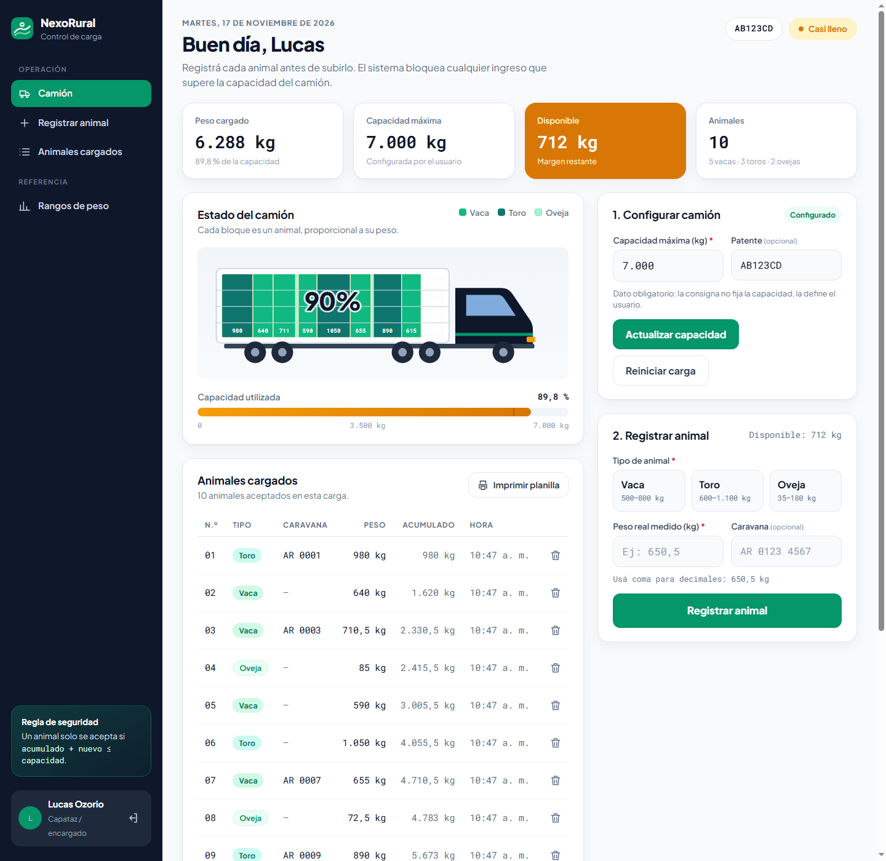

# NexoRural · Control de carga ganadera

**Equipo: AGO Soluciones**

Aplicación web para registrar el peso de cada animal antes de subirlo al camión y **bloquear cualquier ingreso que supere la capacidad máxima** configurada.



## Cómo usarla

No necesita instalación ni servidor: abrí `index.html` en el navegador (doble clic).

1. **Ingresar**: escribí tu usuario y contraseña (en la versión 1 el acceso es local, sin base de datos).
2. **Configurar camión**: ingresá la capacidad máxima en kg y, si querés, la patente. Después tocá *Iniciar carga*.
3. **Registrar animal**: elegí vaca, toro u oveja, escribí el peso real y tocá *Registrar animal*.
4. El sistema calcula `pesoAcumulado + pesoNuevo`:
   - si es **≤ capacidad**, acepta el animal y actualiza los indicadores;
   - si es **> capacidad**, muestra **«Capacidad máxima superada»** y no cambia nada.
5. Si cargaste algo por error, eliminalo desde la tabla (podés *Deshacer*).
6. *Imprimir planilla* genera una hoja con el detalle y espacio para la firma.

La carga en curso queda guardada en el navegador, así que no se pierde si se recarga la página.

## Funciones (requisitos del análisis)

| Código | Requisito | Dónde |
|---|---|---|
| RF-01 | Configurar capacidad máxima | Tarjeta «1. Configurar camión» |
| RF-02 | Seleccionar tipo de animal | Botones Vaca / Toro / Oveja |
| RF-03 | Ingresar peso | Campo «Peso real medido» (acepta `650,5` o `1.100`) |
| RF-04 | Validar datos | Rechaza vacío, texto, 0 y negativos: «Ingrese datos válidos» |
| RF-05 | Controlar capacidad | `js/logic.js` → `evaluarRegistro()` |
| RF-06 | Bloquear exceso | Mensaje en rojo «Capacidad máxima superada» + el camión marca el exceso |
| RF-07 | Actualizar indicadores | Peso cargado, capacidad, disponible, cantidad y barra de progreso |
| RF-08 | Listar registros | Tabla «Animales cargados» con acumulado |
| RF-09 | Eliminar registro | Botón de papelera, recalcula todo, con opción *Deshacer* |

Extras: advertencia si el peso está fuera del rango orientativo de la especie (hay que confirmar), caravana opcional, patente, barra que pasa a ámbar al 85 % y a rojo al llenarse, diseño adaptable a celular/tablet/PC y planilla imprimible.

## Estructura del proyecto

```
nexorural/
├── index.html              Pantalla de ingreso
├── panel.html              Panel de carga
├── css/styles.css          Estilos (paleta y tipografías del análisis)
├── js/
│   ├── logic.js            Reglas de negocio (sin interfaz, testeable)
│   ├── app.js              Interfaz del panel
│   └── login.js            Ingreso
├── assets/logo.svg
├── database/
│   ├── nexorural_estructura.sql   Estructura para phpMyAdmin
│   └── datos_iniciales.sql        Catálogo de especies (opcional)
├── tests/
│   ├── index.html          Casos de prueba en el navegador
│   ├── casos.js            Casos de la sección 12
│   └── run-node.js         Mismos casos desde la terminal
└── docs/
    ├── GUIA_BASE_DE_DATOS.md
    ├── Analisis_informatico_control_carga_ganadera.docx
    └── capturas/
```

## Pruebas

- En el navegador: abrir `tests/index.html`.
- En la terminal (con Node): `node tests/run-node.js`

Cubren todos los casos de la sección 12 del análisis (aceptar en 4.800, rechazar en 5.100, aceptar justo en 5.000, datos inválidos, eliminar y recalcular, rango orientativo) y varios más.

## Base de datos

La versión 1 funciona sin base de datos. Para la siguiente etapa (PHP + MySQL) está lista la estructura en `database/` y una guía paso a paso para importarla en phpMyAdmin: [docs/GUIA_BASE_DE_DATOS.md](docs/GUIA_BASE_DE_DATOS.md).

## Diseño

- Azul pizarra `#0F172A` / `#1E293B` — barra lateral y textos
- Verde esmeralda `#059669` / `#10B981` — botones principales y estados OK
- Ámbar `#D97706` y rojo `#DC2626` — advertencias y exceso de carga
- Gris hielo `#F8FAFC` y blanco — fondos de tablas y formularios
- Tipografías: **Plus Jakarta Sans** (interfaz) y **Roboto Mono** (pesos, patentes y caravanas)

<p align="center"> </p>

---

Desarrollado por **AGO Soluciones**.
